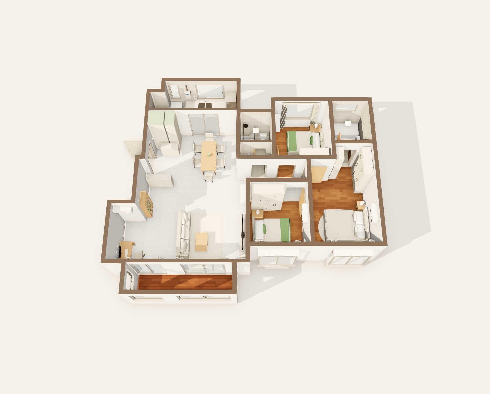
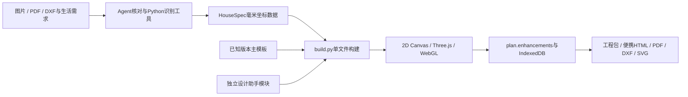

# 户型装修设计助手 · 2.0 增强版

把户型图片、PDF、DXF还原成可编辑的离线装修设计器，继续做家具水电、开放分区、收纳预算、方案比较与施工协作。

**[在线项目主页](https://www.daguojueqi.site/house-plan-designer/) · [直接体验已设计的户型](https://www.daguojueqi.site/house-plan-designer/demo/) · [下载发行版](https://github.com/chencheng666/house-plan-designer/releases/tag/v2.0.0) · [Agent使用流程](SKILL.md)**



本仓库基于 [ZWD11/house-plan-designer](https://github.com/ZWD11/house-plan-designer)（MIT）扩展，由陈成维护2.0增强版。感谢上游作者提供的离线设计器和识别工作流，保留其版权及许可。上游`main`保留原历史，已验收的增强版本在默认分支`enhanced-v2`，不会把未经复核的新模板自动混入发行版。

## 能解决什么问题

- 一张平面图难以讨论家具、通道和空间关系：2D、3D、漫游共用同一份数据，改完即可查看。
- 书房客厅打通以后仍要安排用途：独立功能分区表达工作、会客、家政区，不依赖新建隔墙。
- 方案越来越多，记不清改过什么：整栋快照、真实三维图片对比、差异标记、恢复备份和冲突合并。
- 图好看，但预算与现场脱节：收纳按人分配，费用分项填写，点位、柜体、节点和采购验收一起记录。

在线Demo是已经还原好的D户型，可直接编辑。制作新户型需使用Agent+本地识别脚本或自行编写HouseSpec；网页中没有通用AI户型识别接口。

## 功能

主设计器提供2D/3D、家具家电、水电管线、多楼层、顶面铺装、漫游、光线追踪和PDF/DXF图纸。右下角「设计助手」新增十二页：

| 模块 | 可操作内容 |
|---|---|
| 生活需求 | 家庭成员、办公座位、鞋量、挂衣量与通行目标 |
| 开放分区 | 多边形功能区、材质、分区灯具，保持连续开放空间 |
| 动线净距 | 操作包络、床侧、门扇与100mm网格通行路线 |
| 收纳 | 柜体用途、成员归属、鞋位、挂衣及容积估算 |
| 方案对比 | 整栋快照、三维截图并排比较、差异标记及三方合并 |
| 模型材料 | 静态GLB/glTF与配套文件、实物尺寸、用户贴图和材料组合 |
| 预算 | 主材、人工、主材损耗、运费、预算上限及替代材料 |
| 采光视线 | 跟随主设计器的日照参数、简化遮挡、入户隐私和电视视距 |
| 深化设计 | 柜体柜格、灯光情景、点位CSV和收口节点SVG |
| 采购施工 | 工期、采购、负责人、验收记录、照片及日历 |
| 批注协作 | 对象定位、负责人、处理状态、实际截图与离线批注包 |
| 工程交付 | 完整工程、便携HTML、识别依据、尺寸链及旧编辑恢复 |

详见[设计助手说明](reference/assistant-guide.md)和[原设计器使用说明](reference/designer-usage.md)。

## 如何使用

### 先体验，不安装开发环境

打开[在线Demo](https://www.daguojueqi.site/house-plan-designer/demo/)，试试移动家具、切换2D/3D，再从右下角打开设计助手。

[离线设计器HTML](https://www.daguojueqi.site/house-plan-designer/downloads/d128-designer.html)下载后双击即可使用。网页编辑本身不需要安装Python、Node.js。重要方案下载「完整工程包」，跨设备使用「便携HTML」或「分享文件」，不要只依赖浏览器缓存。

### 把自己的户型交给Agent

1. 将本仓库作为`house-plan-designer`安装到Agent的技能目录，例如Codex的`~/.codex/skills/house-plan-designer/`。可以使用[Skill发行包](https://github.com/chencheng666/house-plan-designer/releases/tag/v2.0.0)，解压后将同名目录放入技能目录。
2. 在技能目录执行`python3 scripts/setup.py`，再执行`python3 scripts/setup.py --check`。生成与验收需要Python3.12+、Node22.12+、本机Chrome/Edge。Python依赖安装在技能自己的`.venv`中。
3. 给Agent一张带尺寸的图，并说明生活和结构要求，例如：

> 按这张户型图做装修设计器。书房与客厅打通，厨房和家政区连通，保留三间卧室。先按标注尺寸还原，列出不确定的设备井和墙厚，再布置家具、水电和收纳。

4. 对照原图核对墙、门窗和尺寸，再进入方案讨论。识别、生成、自查及验收步骤见[SKILL.md](SKILL.md)。

DWG需先转DXF/SVG或PDF。城市、北向、墙厚、层高和结构性质没有依据时保留待核实，不把默认参数写成已确认信息。

### 开发者复现D户型

```bash
git clone https://github.com/chencheng666/house-plan-designer.git
cd house-plan-designer
python3 scripts/setup.py
.venv/bin/python scripts/build.py examples/d128/spec.json -o d128.html
node scripts/check.mjs d128.html artifacts/check-d128 --strict
```

Windows将`.venv/bin/python`替换为`.venv/Scripts/python.exe`。`examples/d128/spec.json`包含匿名几何、布置、开放分区和确认依据，未包含原始图片。图中的128㎡是原户型标称建筑面积，模型自动计算的净面积约95.73㎡，两者口径不同。

## 架构



- 识别层：`analyze.py`、`cadvec.py`、`cadsplit.py`等处理图像与矢量；Agent核对标注和未知项。
- 数据层：HouseSpec描述墙、门窗、家具、结构、点位与材质。进入设计器后用同一份方案数据驱动2D/3D。
- 构建层：`build.py`嵌入预设；`assistant_bundle.py`检查已知模板SHA256和唯一接口，注入扩展。主TypeScript源码不在仓库中，新增扩展有独立可维护源码。
- 交互层：`assets/assistant/core.mjs`负责计算，`ui.mjs`和`assistant.css`负责设计助手。
- 保存层：小数据在`plan.enhancements`，模型、贴图、截图、快照在IndexedDB；完整工程包一起带走。稳定标识和源修订检查帮助保留修改。
- 发布层：本站为静态文件，Nginx托管。没有为Demo增加服务端AI或用户账号后端。

## 验收与使用边界

本轮macOS Chrome实际验证：原有交互110项、新增交互24项、Python/Node程序回归32项通过；本示例32页PDF逐页查看。光追按默认120秒预算自动保存，实际168次采样，未宣称达到512次目标。还验证了断网启动、真实模型导入、分享转便携后的继续编辑和刷新保留。其他操作系统本轮未逐一真机验收。

```bash
.venv/bin/python -m unittest discover -s scripts/tests -p 'test_*.py'
node --test scripts/tests/*.test.mjs
node scripts/qa.mjs d128.html artifacts/完整验收
node scripts/qa-assistant.mjs d128.html artifacts/助手验收
.venv/bin/python scripts/qa_files.py artifacts/助手验收/downloads
```

[验收摘要](reference/acceptance-v2.json) · [版本记录](CHANGELOG.md)

采光、通行、容量及预算是有明确假设的辅助计算；结构拆改、设备安装和施工尺寸应结合专业图纸与现场复核。模型支持普通静态GLB/glTF，骨骼/Draco/KTX2需先转换；协作通过离线文件交换。方案三维对比使用保存的真实图片，原生PDF/DXF与新增分区/节点SVG分别输出。

## 交流与致谢

遇到问题可[提交Issue](https://github.com/chencheng666/house-plan-designer/issues)，附上版本、浏览器、步骤和截图；不需要上传个人住址或完整私密工程。

增强版维护：陈成。公众号：**数字机器莱西奥**。

核心上游：[ZWD11/house-plan-designer](https://github.com/ZWD11/house-plan-designer)。[MIT许可证](LICENSE) · [上游原功能说明归档](docs/upstream-readme.md)。
